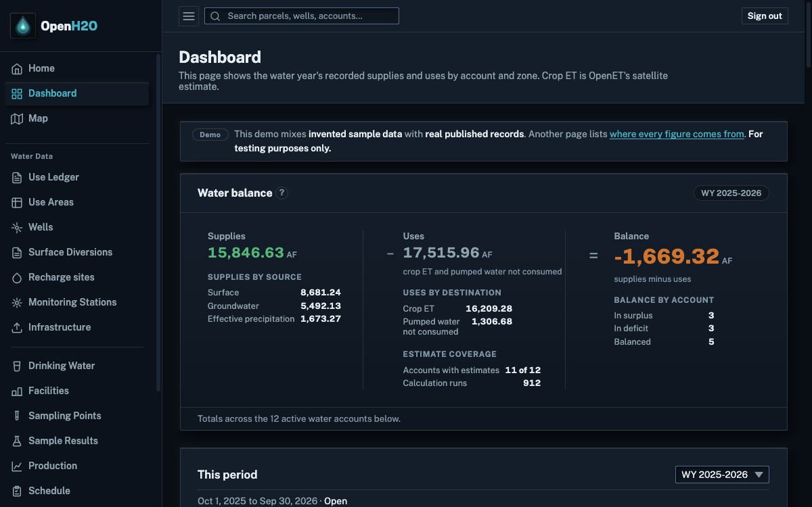
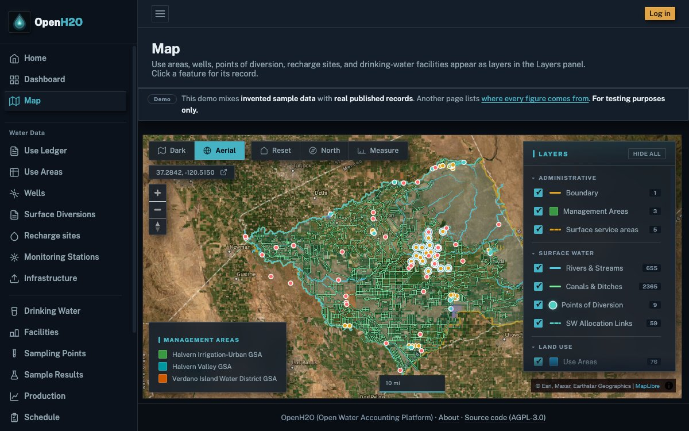
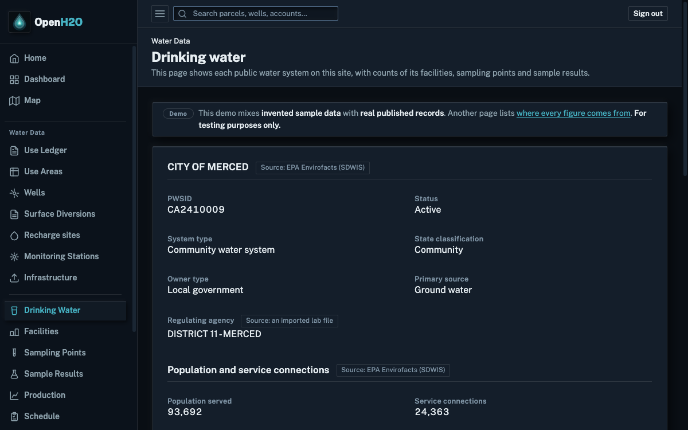

<!-- SPDX-License-Identifier: AGPL-3.0-or-later -->

<p align="center"></p>

# OpenH2O (Open Water Accounting Platform)

OpenH2O is water-data management software that an organization can run on an office computer, its own servers or a rented server costing about $15 a month, with an AI agent doing the installation.

OpenH2O keeps an organization's own water records: measurements, deliveries, wells, diversions, recharge and drinking-water quality results. Satellite evapotranspiration (ET) from OpenET is one of its data sources. A feature that writes figures in California's reporting format is under development and switched off by default. OpenH2O does not submit reports to the state. OpenH2O and the software it runs on are open source, so any organization, or an engineering firm working for one, can run it, read it and improve it.

> **Live demo:** [openh2o.com](https://openh2o.com) · **License:** [AGPL-3.0-or-later](#license) · **Deploy guide:** [DEPLOY.md](DEPLOY.md) · **Deploy it with an AI:** [docs/AI-OPERATOR-GUIDE.md](docs/AI-OPERATOR-GUIDE.md)

---

## Who this is for

OpenH2O is for anyone who keeps water records, anywhere in the United States: engineers and managers at water agencies and districts, growers, ditch tenders and drinking-water system operators.

In California, the **Sustainable Groundwater Management Act (SGMA)** requires hundreds of local **Groundwater Sustainability Agencies (GSAs)** and water districts to account for the water their basins use. Many of them are small and have no software staff. The water-accounting software available today is excellent but expensive, and a vendor runs nearly every installation. OpenH2O is meant to make water-accounting software affordable for those organizations.

<!-- defines: repository -->
> **An organization with no software staff can install OpenH2O itself:** point a frontier AI agent at this *repository* (a folder holding all of the program's files, kept on a website called GitHub with a complete history of every change ever made to it) and at a low-cost rented computer, and the agent does the installation, with no purchasing process to wait for. An engineering firm or consultant can run OpenH2O just as well, and for many organizations that is the sensible choice. Because an organization can also install it with its own staff, a vendor contract is a choice and not a requirement.

Each OpenH2O site keeps the water records of one organization: a district, an agency, a farm or a ditch company. OpenH2O accounts for surface water and groundwater, separately or together, and for active recharge.

### A note on terms
- **GSA**: Groundwater Sustainability Agency, the local body responsible for a basin under SGMA.
- **OpenET**: a service that publishes satellite estimates of evapotranspiration. OpenH2O uses them to estimate consumptive use.

---

## Three ways to deploy

| Path | Who it's for | Start here |
|------|--------------|------------|
| **AI-operated** | An organization with no software staff, using a frontier AI agent | [docs/AI-OPERATOR-GUIDE.md](docs/AI-OPERATOR-GUIDE.md) |
| **Manual deploy** | An IT person or consultant installing it on a new Linux server | [DEPLOY.md](DEPLOY.md) |
| **Single computer** | An organization running it on one office computer or a laptop | [Quick start](#quick-start-single-computer) below |

The three paths install the same software. The configuration depends on who needs
to reach the site: people at the computer itself, people on an office network, or
anyone on the internet. Only a site on the internet needs a domain name and
encryption.

<!-- defines: tls_https -->
*HTTPS* encrypts the connection between a browser and a website, and the browser
shows a padlock when it is in use. HTTPS depends on a *certificate*, a file that
proves the address belongs to the site. A site that only people inside the
building can reach can run without either.

<!-- defines: docker -->
Each path normally uses Docker, and each can also be done without it. OpenH2O
ships as three *containers*. A container is a sealed package that holds one part
of the program and everything that part needs, and it runs the same way on any
computer. Docker is the program that builds and runs containers. Without Docker,
you install OpenH2O's parts directly on the computer. Installing without Docker is
the only option on a hosted server whose provider does not allow containers.
[docs/INSTALL-WITHOUT-DOCKER.md](docs/INSTALL-WITHOUT-DOCKER.md) describes the whole
process.

A new installation starts with an empty database. The setup steps then load the
Merced Subbasin demonstration, a real California basin with published records and
invented sample data, which you can explore before you load your own. The
demonstration is labeled as demonstration data wherever it appears, and replacing
it with your organization's own basin is the usual next step.

### Quick start (single computer)

```bash
git clone https://github.com/Open-H2O/openh2o.git
cd openh2o
cp .env.example .env
# For a quick look on your own machine, set these two lines in .env:
#   SECRET_KEY=<any-random-string>             # base settings require it, no default
#   DJANGO_SETTINGS_MODULE=config.settings.local   # dev mode: DEBUG on, dev DB password is fine
#
# WARNING: config.settings.local is for LOOKING AT IT, not for holding an
# organization's real records. DEBUG=True prints the site's internals on any
# error page, and it defaults ALLOWED_HOSTS to "*" if you set none. To run
# OpenH2O with real records on one computer, use production settings with the
# three plain-HTTP flips - see docs/AI-OPERATOR-GUIDE.md Phase 2.
docker compose up -d --build         # start db + web + caddy
docker compose exec web python manage.py migrate
docker compose exec web python manage.py seed_data      # reference data
docker compose exec web python manage.py seed_merced    # the Merced Subbasin demonstration
docker compose exec web python manage.py createsuperuser   # your login for the trial
```

Use these settings only to look around. To keep real records on one computer, use
the production settings described in
[docs/AI-OPERATOR-GUIDE.md](docs/AI-OPERATOR-GUIDE.md), Phase 2.

<!-- defines: localhost -->
<!-- defines: superuser -->
Open `http://localhost` and sign in with the *superuser* you just created.
`localhost` and `127.0.0.1` both mean the computer you are using, and only that
computer can reach the site at those addresses. The superuser is the one account
that can do everything in OpenH2O: add staff accounts, change settings and see
every page. It is separate from your computer login, and you create it by hand
before anyone can sign in. Most pages need a sign-in, and a new site keeps sign-up
closed through the `ACCESS_CONTROL_ENFORCED` setting. The public demo at
openh2o.com turns that setting off.

<!-- defines: seed_data -->
You will see the **Merced Subbasin** demonstration, the same one running at
[openh2o.com](https://openh2o.com). *Seeding* means loading a starting set of data
into the empty database: small reference lists such as units and categories, or a
whole demonstration dataset. The demonstration seed takes a few minutes to download
hydrography and monitoring stations from public government services. It also loads
the demonstration's water rights, deliveries, parcels and ledger entries. These
steps work without any key.

Consumptive-use figures need an OpenET key (free from
[etdata.org](https://etdata.org)), because OpenH2O calculates them from satellite
ET. `run_calculations` also needs a calculation method, which only
`seed_calculation_plan` creates. The demonstration seed ends with a list of
anything still missing. For a site with a domain, encryption, scheduled data
updates and production security settings, follow [DEPLOY.md](DEPLOY.md).
`make help` lists every shortcut command.

---

## The AI agent keeps working after setup

For an organization with no software staff, a capable AI agent such as Claude Code
can install OpenH2O and then keep running the site and explaining it to the staff.

- **Loading existing records.** Point the agent at the records you already have,
  such as a county assessor's parcel export, a set of spreadsheets or an export
  from an old system. The agent works out how your columns match OpenH2O's
  importers and loads the records. The import tools accept your own field names,
  check a file in a dry run before writing anything, and hold each file in a
  staging table, which keeps a bad file from leaving your data half-changed. See
  [docs/DATA-IMPORT.md](docs/DATA-IMPORT.md).
- **Routine work.** The agent can run the monthly data updates, remove monitoring
  stations that have stopped reporting and read the health check on a schedule. It
  can also explain what each health check result means.
- **Troubleshooting.** When something breaks, the agent can read the logs and the
  deployment guide and often fix the problem without a vendor's support ticket.

[docs/AI-OPERATOR-GUIDE.md](docs/AI-OPERATOR-GUIDE.md) takes an agent through the
installation and through each of these jobs.

---

## What it looks like

These screenshots are from the live demo at [openh2o.com](https://openh2o.com),
which runs the Merced Subbasin dataset. Invented sample data carries a *Demo* label
and appears beside the real published records.

**The accounting dashboard** shows supplies, consumptive use and the balance
between them for the selected water year, and lists the items that need attention
at the top.



**The map** shows the boundary, GSA zones, rivers and canals, parcels, wells,
points of diversion, recharge sites and drinking-water facilities, each as its own
layer. On the demo, anyone can open the map without signing in.



**The drinking-water module** shows a public water system under its EPA PWSID and
names the source of every figure.



---

## What it does

<!-- defines: postgis -->
- **Parcels and wells** with their locations and boundaries, plus points of diversion and well inventories. Every record is stored in *PostgreSQL*, the database program behind the site. *PostGIS* is the add-on that lets PostgreSQL work with maps, boundaries and points.
- **A water ledger** that records supplies, use and allocations by water type and zone. Every figure can be traced to its entries.
- **Surface-water rights**, with points of diversion and diversion records.
- **Managed aquifer recharge** sites and events.
- **Drinking-water quality.** Water systems, facilities and sampling points are kept under their EPA PWSID. The module includes an importer for California DDW lab exports and a setup wizard that fills in a system's details from public records when you enter its PWSID. Quality and quantity records live in the same site.
- **Data from public sources.** <!-- defines: api_key --> USGS, CDEC and DWR's Water Data Library and SGMA Portal are switched on and need no credentials. CIMIS and NOAA are switched on and start fetching once you add a free API key. An *API key* is a long password-like string that lets a program fetch data from another organization's computers. Treat it like a password. CNRFC and OpenET satellite ET are off until you turn them on, and OpenET also needs a key. OpenH2O maps every source's data to one shared vocabulary (see [Data standards](#data-standards--interoperability)).
- **Reporting (under development, off by default):** figures written in California's reporting format. OpenH2O does not submit reports to the state.
- **Open-standards publishing (not yet live).** The data model is designed for publishing as OGC SensorThings, Frictionless Data Packages and WaDE 2.0, but OpenH2O does not publish anywhere yet.
- **A health dashboard** that shows how current each data source is.
- **Interactive maps** built with MapLibre GL JS. The maps open on aerial imagery, with a dark basemap one click away.
- **In-app feedback (optional, off by default).** A built-in form lets users send bug reports, ideas and questions without leaving the site, and it attaches screenshots and diagnostics automatically. Reports are stored on the site and can also be forwarded to a triage service. Turn it on with `FEEDBACK_ENABLED=True` on a site where someone will read the reports.

---

## Data standards & interoperability

Every measurement OpenH2O stores or receives is mapped to one shared vocabulary,
which lets the data be published to open standards without remapping for each
site.

- The **ObservedProperty registry** links every measured quantity (stream discharge, depth to groundwater, ET, reservoir storage and others) to its **USGS parameter code**, **EPA WQX characteristic name** and **UCUM unit**.
- A **SourceParameter crosswalk** maps each outside source's own parameter codes to that vocabulary. USGS code `00060`, CDEC code `20` and a CNRFC streamflow forecast all resolve to the same `discharge` concept.
- Measurements carry **quality flags** (provisional, approved or estimated), and groundwater wells carry a **vertical datum** (NAVD88 or NGVD29). Both follow OGC SensorThings conventions.
- A **conformance check** (`check_conformance`) lists every measurement that cannot yet be published, such as one with no unit or no crosswalk entry. The check exits with an error when it finds one, which lets a script stop on it. Someone has to run it by hand, and OpenH2O does not publish anywhere yet.

The full crosswalk, the standards roadmap (OGC SensorThings API, Frictionless,
WaDE 2.0) and a machine-readable export are in
**[docs/DATA-STANDARDS.md](docs/DATA-STANDARDS.md)**. If you run another water-data
platform, the registry and the crosswalk are the parts you can reuse directly.

---

## Tech stack

<!-- defines: reverse_proxy -->
<!-- defines: cron -->
<!-- defines: docker_compose -->
**Caddy** is a *reverse proxy*: a program that receives traffic from outside and
passes it to OpenH2O. Caddy also obtains the encryption certificate automatically.
***cron*** is Linux's built-in scheduler, which runs commands on a timetable, such
as every night at 2 a.m. **Docker Compose** is a tool installed with Docker that
starts, stops and rebuilds all three containers together from one file,
`docker-compose.yml`.

| Component | Technology | Why |
|-----------|------------|-----|
| Framework | Django 5 + GeoDjango | A complete web framework with built-in map support, all in Python |
| Database | PostgreSQL 16 + PostGIS 3.4 | The standard open-source database for spatial data |
| Frontend | HTMX + Tailwind (standalone binary) | No Node.js tools to maintain |
| Maps | MapLibre GL JS | Open vector maps with no API key |
| Reverse proxy | Caddy | Automatic HTTPS with almost no setup |
| Background work | Django management commands + cron | Small enough for 2–4 GB of memory without Celery or Redis |
| Packaging | Docker Compose | One command starts everything |

OpenH2O has no Node.js build step and does not use Celery or Redis, which keeps it
small enough for a server with 2 to 4 GB of memory. Each site serves one
organization (no multi-tenancy).

---

## Repository layout

```
openh2o/
  config/        Django project + settings (base / local / production)
  core/          User model, roles, site config, seed commands
  geography/     GSA boundaries, management zones, basin codes
  parcels/       Parcel registry and the accounting ledger
  wells/         Well inventory and meters
  measurements/  Meter readings, sensors, quality flags
  accounting/    Water accounts, allocations, reporting periods
  surface/       Surface-water rights, points of diversion, diversions
  recharge/      Managed aquifer recharge sites and events
  drinking/      Drinking-water systems, facilities, sampling points, lab results
  infrastructure/ Unified CRUD for wells, PODs, recharge sites
  datasync/      External data adapters (7 sources + OpenET)
  setup/         First-run setup wizard (watershed, sources, imports)
  reporting/     California's reporting format (under development, off by default)
  standards/     Canonical vocabulary, crosswalk, conformance gate
  health/        System health checks and data pruning
  feedback/      In-app feedback widget intake (stores + optional forward)
  templates/     Django templates (HTMX partials)
  static/        Design tokens, compiled CSS, map toolkit
  tests/         pytest suite (factory_boy fixtures)
  docs/          Deployment, AI operator, data standards, and tier guides
```

## Cost to run

<!-- defines: google_earth_engine -->
<!-- defines: smtp -->
**Google Earth Engine** is a separate Google service for processing satellite
imagery at large scale. Only an organization with thousands of parcels needs it.
**Transactional email** is how a website sends its own messages, such as password
resets, through an outside mail provider.

| Item | Typical cost |
|------|--------------|
| Virtual server (2–4 GB RAM) | $15–30 a month |
| Domain name | About $12 a year |
| OpenET (satellite ET) | A free API key covers a small number of parcels. For thousands of parcels, the Earth Engine tier costs a few dollars a year in computing time, plus a plan fee of at least $500 a month unless Google approves the organization for its no-fee Limited plan (see [docs/earth-engine-tier-setup.md](docs/earth-engine-tier-setup.md)). |
| Transactional email (password resets) | A free tier covers most organizations |
| CIMIS / NOAA / CDEC / USGS / DWR data | Free (public APIs) |

## Testing

```bash
make test     # pytest, pinned to local settings
```

<!-- defines: allowed_hosts -->
The tests use pytest, pytest-django and factory_boy and live in [tests/](tests/).
The production settings will not start with an empty or well-known database
password, or without a real `ALLOWED_HOSTS`. `ALLOWED_HOSTS` is the list of web
addresses the site answers to, and the site refuses requests addressed to any other
name. `make test` therefore runs with `--ds=config.settings.local`.

## Contributing

Issues and pull requests are welcome. See [CONTRIBUTING.md](CONTRIBUTING.md).
Because OpenH2O is licensed under the AGPL, contributions are made under the same
license.

## License

OpenH2O is licensed under the **GNU Affero General Public License, version 3 or
later (AGPL-3.0-or-later)**. See [LICENSE](LICENSE) and [NOTICE](NOTICE).

The AGPL is written for software that people use over a network. Its
**Section 13** says that if you run a modified version of OpenH2O and let people use
it over a network, you must offer those users the source code of your version. Any
organization or vendor that improves OpenH2O and hosts it therefore has to offer its
users the improved code.

## Acknowledgments

OpenH2O builds on earlier work. Its idea and much of its accounting method come
from the **Groundwater Accounting Platform**, open-source software that **ESA
(formerly Sitka Technology Group)** develops and the **California Water Data
Consortium** oversees. The Consortium is the nonprofit set up in 2019 to open up
California's water data. The Groundwater Accounting Platform is also released
under the AGPL.

OpenH2O was written from scratch in Python and does not use any of the Groundwater
Accounting Platform's code. We studied how the Groundwater Accounting Platform
works, and we are grateful to the people who built it.
